# MXT Manufacturing ERP

Implemented by **Muhammad Shahyan Khalid**.

This repository contains an independently reconstructed demonstration of ERP
workflows based on previous implementation experience. It uses fictional
business data and does not include client-owned source code or production records.

Target: **Odoo 17 Community**, Python ORM, PostgreSQL. Source: `addons/mxt_operations`.
Database: `mxt_demo`. Browser: http://127.0.0.1:8171. Test database: `mxt_test`.
Current verification and outstanding work: [docs/VERIFICATION.md](docs/VERIFICATION.md).

Validated native milestone: **24 automated test methods passed in a fresh Odoo
database**, clean install and upgrade succeeded, real browser screens were
captured, and a QWeb PDF was rendered and visually checked. Docker execution
remains blocked by the host's read-only Docker filesystem. User review is pending.

## Business problem and implemented design

Disconnected customer demand, purchasing, warehouse supply and production are
coordinated using native Odoo Sales, Inventory, Purchase and Manufacturing.
The custom addon adds controls around those operations:

- Warehouse material policies create **manual-trigger native orderpoints**.
  Confirmed MOs supply actual, variant-aware BOM component demand via stock moves.
  Native forecasts include incoming/outgoing moves and purchase quantities in
  progress. A policy supplies minimum/maximum levels plus a separate safety buffer,
  route and visibility horizon. Native vendor selection, lead times, currency,
  procurement and UoM conversions remain authoritative.
- Native inter-warehouse resupply routes generate outbound and inbound pickings
  through transit. A route to secondary stock avoids purchasing that material
  directly at Production. A Buy policy at the secondary warehouse can replenish
  upstream shortages; there is no invented automatic supplier-selection engine.
- All purchase orders require submission and a different manager's approval.
  Above a configurable company-currency threshold, a third person must approve.
  This applies to direct record calls as well as buttons. Reviewed commercial
  fields and lines are frozen until approval is reset. Workflow events are
  append-only, actor-stamped and company restricted.
- A Kanban board adds Planned → Material Review → Materials Ready → In Production
  → Quality Review → Completed. Components must be reserved before entering Ready
  or Production. Native MO completion requires an authorized inspection pass.
  Rework returns the order to Production. Inspection rejection blocks completion.
  An inspection fingerprint binds the pass to actual quantities and traceability;
  subsequent changes require rework and another inspection.
- QWeb manufacturing/material/quality/routing and policy decision PDFs complement
  the native purchase and picking reports. Native manufacturing analysis remains
  available for operational quantities and durations.

The custom quality workflow is a Community-compatible demonstration, independently
authored here. It is not Odoo Enterprise Quality.

## Architecture and models

| Model | Purpose |
| --- | --- |
| `mxt.planning.policy` | Warehouse/product thresholds, native route, orderpoint and last decision |
| `mxt.production.stage` | Seeded Kanban stages; ordinary users cannot alter stage definitions |
| `mxt.approval.event` | Immutable purchase review history |
| `product.template` | Material class, default safety stock and displayed minimum vendor delay |
| `sale.order` | Planning note; native MTO/manufacture performs actual demand creation |
| `purchase.order` / `.line` | Review sequence, field freeze, rejection and reset controls |
| `mrp.production` | Reservations, stage transitions and quality gates |
| `stock.picking` | Material coordination note; native stock transactions unchanged |
| `res.company` | Proposed configurable final approval threshold |

There are no cross-project addon dependencies. Only the declared public Odoo
Community modules are required. The manifest and Python/XML source use Odoo 17
APIs (`tree`, `kanban-box`, `fields.Command`, stock move `quantity`). Do not install
this addon on Odoo 18/19 without a separate migration and regression run.

```mermaid
flowchart LR
  SO[Confirm Sales Order] --> MTO[Native MTO and Manufacture]
  MTO --> MO[Confirmed Manufacturing Order]
  MO --> BOM[Native BOM Component Stock Moves]
  BOM --> Forecast[Native Orderpoint Forecast]
  Policy[Warehouse Policy and Safety Buffer] --> Forecast
  Forecast --> Buy[Buy Route: Draft RFQ]
  Forecast --> Transfer[Resupply Route: Pickings Through Transit]
  Buy --> Approval[Submit and Independent Approval]
  Approval --> PO[Confirm PO and Receive]
  PO --> Reserve[Reserve Components]
  Transfer --> Reserve
  Reserve --> Board[Production and Inspection]
  Board --> Pass{Authorized Pass?}
  Pass -->|Yes| Done[Native MO Completion]
  Pass -->|Rework| Board
```




## Docker setup

Docker Compose v2 is required. Images are pinned to immutable digests in
`docker/images.lock.json`; `scripts/bootstrap.py` reads that lock. Docker creates
only project-prefixed volumes and an internal network; the database has no host
port. Odoo binds to loopback port 8171. No employer directory is mounted.

From PowerShell in this project directory:

```powershell
python scripts/bootstrap.py
.\scripts\lab.ps1 -Action init
.\scripts\lab.ps1 -Action up
.\scripts\lab.ps1 -Action test
.\scripts\lab.ps1 -Action upgrade
.\scripts\lab.ps1 -Action stop
```

`init` installs without Odoo's unrelated demonstration records, then loads only
the fictional custom scenario through Odoo's XML importer. The fixture marker and
external IDs prevent stock reseeding and duplicate sales on repeat runs. Cron is
disabled initially so manual reviews are predictable.

Read local credentials from `.local/credentials.json`; do not publish or screenshot
that file. `admin`, `lab.buyer`, `lab.manager`, `lab.final`, `lab.operator` and
`lab.quality` have separately generated passwords. No reusable password is shipped.

To explicitly reset **only this lab's demonstration database**:

```powershell
.\scripts\lab.ps1 -Action reset
```

The test command uses a separate named database. See the native runtime guide if
Docker cannot run. Current machine: Docker's data filesystem is read-only and C:
reported no free space; no Docker reset or host cleanup was performed. Compose
syntax validation is separate from a successful container installation.

## Demonstration data

Example Fabrication Lab has four fictional warehouses: Raw Materials (`LRAW`),
Secondary Supply (`LSUP`), Production (`LPRD`) and Finished Goods (`LFIN`). Production
is natively configured to resupply from Secondary.

Three utility cabinets require six steel panels and three fastener packs.
Secondary initially holds 40 panels; Production holds one pack. The draft
quotation is linked to native MTO and Manufacture routes. Supplier lead times are
three and two days; these are demonstration values. Two material policies include
configured safety and maximum levels. Expected quantities are explained in the
manual review guide, rather than asserted as historical business rules.

Synthetic records live in `addons/mxt_operations/demo/scenario.xml` and the scoped
`_seed_demo` installer. No database dump or historical client data is shipped.

## Security

Procurement User/Manager/Final Approver, Warehouse Operator/Manager, Manufacturing
Operator/Production Supervisor, Quality Reviewer and Material Planning Manager
map to appropriate native groups. Purchase roles have native access to purchase
financial fields; warehouse/manufacturing roles receive no additional purchase
financial rights. Policy and approval event record rules enforce allowed companies.
Native stock/MO/purchase company rules also remain enabled.

Workflow methods check record access and roles server-side. Elevation is limited
to appending immutable audit records with the actual caller and to install-only
fictional fixture settings. Procurement and stock processing run through normal
ORM privileges. Repeated custom scheduler calls serialize per company with a
transaction advisory lock; managed orderpoints are manual-trigger to avoid a
second native scheduler processing them concurrently.

Settings administrators are trusted to configure policy and roles. The initial
demo administrator has all lab roles, but separation-of-duty checks still require
different users for purchase approvals. Use the supplied separate role accounts.
Never connect these fixtures to real outbound email or production systems.

## Testing and review

Automated tests cover BOM quantities, UoM conversion, shortage calculation,
existing supply, repeat scheduling, native inter-warehouse movements, purchase
approval tiers and bypass attempts, self-approval, line freezing, immutable history,
material/quality gates, rework, native stock completion, sales-to-MO demand,
company isolation, and QWeb rendering. Results are recorded only after execution
in [docs/VERIFICATION.md](docs/VERIFICATION.md).

Follow [docs/MANUAL_REVIEW.md](docs/MANUAL_REVIEW.md) to test the actual UI.
Screenshots, if present, are genuine captures of this fictional environment.
Screenshots document the fictional manufacturing environment.

## Evidence, assumptions and limitations

The supplied brief documents manufacturing planning, multiple warehouses,
purchase approvals, Kanban, quality controls, reports and custom ORM work. Exact
fields, thresholds, routing and inspection requirements are only partially
documented. Everything in this addon is newly written, not recovered deployment
code. `1000` company-currency units is a configurable proposed threshold; it is
not a historical claim. The stage graph, requirement horizon, safety calculation,
fictional cabinet and approval separation are proposed reconstruction choices.

Native confirmed moves are the source of demand. Draft MOs and unconfirmed sales
do not trigger procurement. Normal subassembly manufacture and phantom expansion
are native Odoo behavior; complex multi-level/subcontract scenarios require more
fixtures and regression coverage before being represented as validated here.
Policies are specific to a product variant and warehouse; the product template
safety value is an onchange default, not an enforced global rule. The displayed
minimum seller delay is informational; procurement uses Odoo's selected seller.

The four warehouses do not imply four legal entities. Finished products are
initially produced into Production stock; movement to Finished Goods is a native
manual internal transfer. No undocumented payroll, Enterprise app, commercial
connector, production deployment claim or measured historical speedup is included.

Publication contents and exclusions are documented in
[PUBLICATION_SAFETY_REPORT.md](PUBLICATION_SAFETY_REPORT.md).
